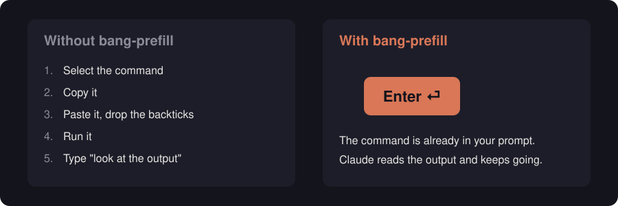

# bang-prefill

**Stop copy-pasting the commands Claude asks you to run.**

When Claude Code suggests a `! <command>`, this mod puts it straight into your prompt box.
Press Enter: the command runs, Claude sees the output and keeps working.

<p align="center">
  
</p>

## Why

<p align="center">
  
</p>

Claude often needs something only you can run: a login, a check on your machine, a command
outside its sandbox. Normally you select it, copy it, paste it, strip the backticks, run it,
and then tell Claude to look at the output. With bang-prefill it is one keystroke, and Claude
picks up the result on its own.

## How it works

1. Claude writes a line that is a whole `! <command>`: as inline code or inside a code block.
2. When the turn ends and your prompt box is empty, the mod fills it with that command.
   If there are several, the last one wins.
3. You press Enter, or edit the command first.
4. The mod runs it with `zsh -lc` and sends Claude the stdout, stderr and exit code
   in place of the `! <command>` text.

Mentions inside a sentence are ignored, and text you have already typed is never overwritten.

## Requirements

- Claude Code **2.1.303** or later, in a terminal session. Tested on 2.1.303.
  bang-prefill is a hooks module ("mod"), an early-access plugin API that may change between releases.
- macOS or Linux with `/bin/zsh`.

## Install

At the Claude Code prompt:

```
/plugin install bang-prefill --marketplace MaximusPokeZ/bang-prefill
```

Answer `y` to add the marketplace, then pick a scope.

From a shell:

```sh
claude plugin install bang-prefill --marketplace MaximusPokeZ/bang-prefill
```

In the desktop app: click **+** next to the prompt box, then **Plugins**, **Add marketplace**
with `MaximusPokeZ/bang-prefill`, then **Add plugin**.

## Limitations

- Interactive commands do not work: the command gets no TTY.
- A command is killed after 10 minutes.
- It runs `/bin/zsh -lc`, so aliases and functions from `~/.zshrc` are not loaded.
- Any prompt you send that starts with `! ` (bang, space) is run as a shell command,
  whether or not the mod filled it in.

## Development

```sh
claude plugin validate .
claude plugin test .
python3 -I scripts/gen-assets.py assets   # regenerate the README images
```

## License

[MIT](LICENSE)
